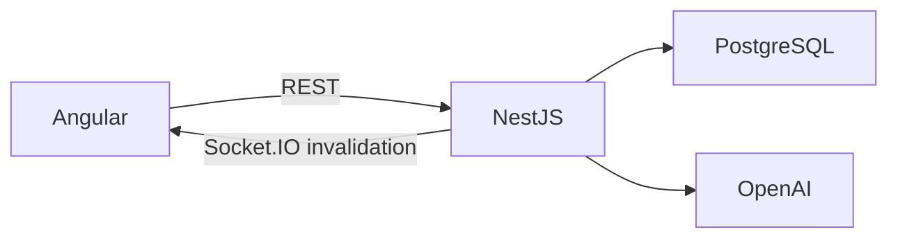

# Arquitectura

Estado: aceptada. Monolito modular con una instancia de NestJS que sirve Angular, REST `/api/v1` y Socket.IO bajo un origen en producción. PostgreSQL 17 es la fuente de verdad. No se requiere Redis para la primera instancia.

## Límites

Identidad administra sesiones opacas en PostgreSQL. Proyectos administra membresía e invitaciones. Kanban aplica reglas en transacciones. Actividad conserva historial y outbox durable. Métricas son funciones deterministas. IA solo recibe contexto autorizado y devuelve propuestas validadas. Demo crea usuarios invitados y proyectos temporales aislados.

## Organización interna

Angular se organiza en `core`, `shared` y `features`. El marco compone navegación, cabecera y vistas; la raíz inicia la aplicación. Sesión, proyectos, tablero, detalle de tarea, equipo, columnas, métricas, actividad e IA tienen propietarios de estado específicos. Las tarjetas y columnas reciben entradas y emiten eventos tipados. Los paneles proyectan su contenido en un contenedor accesible compartido. Los estilos acompañan a los componentes; los tokens y utilidades permanecen globales.

NestJS organiza cada funcionalidad en su propio módulo, controlador y servicios. Los controladores validan Zod y delegan, sin acceso a Prisma. Proyectos separa acceso, ciclo de vida, membresías e invitaciones. Kanban separa consultas, transacciones, tareas, lotes, columnas y comentarios. Actividad expone historial/outbox; colaboración valida conexiones y publica invalidaciones. Métricas separa cálculo puro y consulta. IA separa ejecución, proveedor, simulación, prompts, presupuesto y aceptación; los lotes de tareas los crea el proveedor público de Kanban. Demo separa datos sintéticos, creación y limpieza. Salud y OpenAPI son adaptadores independientes del arranque.

Los módulos consumen los exports de otras funcionalidades. Infraestructura no depende de funcionalidades y los componentes compartidos no dependen del estado de producto. ESLint impide acceso de controladores a la base y acceso a proveedores privados de módulos pares. No se añaden microservicios ni repositorios genéricos.

## Consistencia

Cada comando de tablero recibe expectedVersion. La transacción incrementa atómicamente la versión, escribe el cambio y un evento. Se rechazan conflictos con 409 y el cliente recarga. Socket.IO publica invalidaciones autorizadas; los clientes recargan al reconectar. El outbox reintenta tras reinicios y permite duplicados identificables por evento/versión. El estado actual vive en tablas ordinarias; el historial sirve para auditoría y cálculos.

El cliente mantiene un snapshot confirmado y un movimiento pendiente por separado. Al soltar, proyecta inmediatamente el destino y orden sin modificar la versión confirmada. Conserva la proyección hasta que REST alcanza la versión reconocida por el comando. Un rechazo retira la proyección y reconcilia el último estado autorizado; una pérdida de red o una página de error de la pasarela (502-504) conserva el resultado como incierto hasta una consulta posterior, sin reenviar el comando. Las escrituras se serializan por tablero.

Los formularios de tarea y columna conservan la versión con la que se abrieron. Los cambios ajenos al elemento editado la avanzan; si otra persona modificó ese mismo elemento, el guardado envía la versión original y el servidor responde 409. Tras recargar, el borrador se conserva y volver a guardar es una decisión explícita. Las ediciones parciales solo modifican los campos enviados.

El detalle de tarea pide confirmar el descarte al cerrar con cambios, comentario o criterio pendientes. Recargar o abandonar la página activa la advertencia nativa del navegador. No se persisten borradores en almacenamiento local. Guardar la tarea conserva abierto el panel si queda texto pendiente; una tarea recién creada conserva su identidad para evitar duplicarla en el siguiente guardado.

Las consultas concurrentes de foco, Socket.IO y actualización manual se agrupan. Se rechazan respuestas de un contexto de proyecto anterior o de una versión inferior. Durante el arrastre se difiere la aplicación de snapshots remotos; la revocación borra el estado inmediatamente. Métricas, actividad, comentarios y respuestas de IA comprueban su contexto antes de actualizar la vista.

Mientras el detalle está abierto, cada snapshot confirmado vuelve a consultar su conversación, también tras reconectar. Los comentarios comprueban además tarea, panel abierto y secuencia de petición para descartar respuestas anteriores. La recarga no reemplaza los campos en edición.

Esta refactorización conserva rutas REST, respuestas, cookies, eventos Socket.IO y el esquema PostgreSQL. La resolución del `.env` y de la SPA funciona tanto desde fuentes como desde la imagen compilada.

## Identidad y autorización

Contraseñas Argon2id; token de sesión aleatorio, solo su hash en base de datos. Cookie HttpOnly, Secure en producción, SameSite=Lax. CSRF por token de sesión y comprobación de origen en mutaciones. Roles OWNER/MEMBER/VIEWER por proyecto, comprobados en HTTP y suscripción socket. Revocar membresía desconecta sus sockets del proyecto.

Crear proyectos permanentes requiere una cuenta registrada. El servicio comprueba el usuario persistido y rechaza sesiones invitadas con 403; las demos siguen su ruta de creación aislada con caducidad y cuota propias.

## Datos y métricas

Columnas TODO/ACTIVE/DONE. Eventos inmutables guardan fecha, categoría y nombre de columna para no depender de renombrados. Primera entrada a ACTIVE y primera finalización definen el ciclo inicial; creación a primera finalización define entrega. Reaperturas se cuentan aparte. Throughput cuenta primeras finalizaciones por semana en America/Bogota. Duración por columna suma intervalos, incluido el actual; archivo mantiene historial. Métricas sin muestra devuelven null.

Si la primera entrega ocurre sin inicio en ACTIVE, su ciclo inicial permanece desconocido incluso al reabrir. Los registros históricos con inicio posterior a la primera entrega se excluyen del ciclo, sin convertirlos en ceros; siguen contando para entregas y reaperturas.

## IA

Responses API, modelo configurable, prompts versionados y Zod. Simulador explícito sin clave. Propuestas persistidas; aceptación idempotente y transaccional con expectedVersion. Reservas en un ledger mensual serializado evitan admitir llamadas sobre presupuesto estimado. Las llamadas sin uso confirmado mantienen reserva conservadora. Precios configurables, sin reintentos automáticos pagados. Tokenización aproximada por límite conservador de caracteres; límite real del proveedor para salida. No acceso autónomo a herramientas ni RAG en v1.

## Operación

El proyecto se distribuye como repositorio para ejecutar en local; no hay despliegue público. Docker multi-stage y Compose levantan la aplicación compilada con PostgreSQL; la alternativa sin Docker usa PostgreSQL local mediante un wrapper de desarrollo, que no debe usarse en producción. Health/readiness, request IDs y logs sin secretos. Cualquier despliegue futuro debe mantener una sola instancia (ver ADR 0001). Ver README para ejecución.
